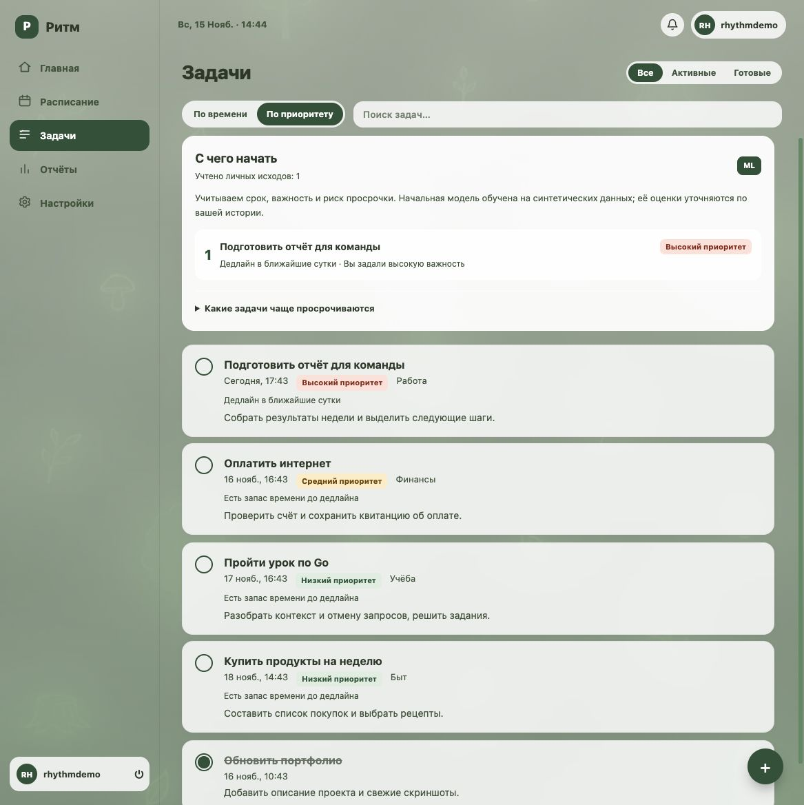
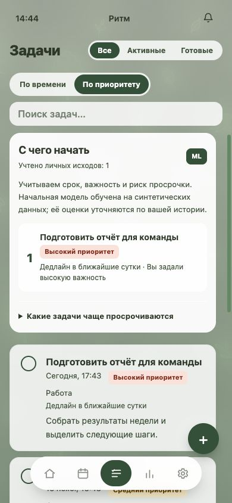

# Ритм · Rhythm

Личный планировщик задач и событий с напоминаниями, отчётами и персональными ML-приоритетами. Работает в браузере на компьютере и телефоне; PWA можно добавить на главный экран.

[](https://github.com/Aam-Shaegar/Rhythm/actions/workflows/ci.yml)


[Открыть приложение](https://rhythm-tesler.duckdns.org) · [Запустить локально](#запуск-за-несколько-команд) · [Архитектура](docs/ARCHITECTURE.md) · [ML-модель](docs/ML-PRIORITIES.md)

## Возможности

- **Задачи:** дедлайны, повторения, поиск, фильтры, оценка длительности и важность. В обычном списке сначала активные задачи по сроку, затем выполненные.
- **Расписание:** события в представлении дня и недели.
- **Напоминания:** до пяти собственных интервалов для задач и событий; невыполненные просроченные задачи напоминают о себе каждые два часа. Web Push при поддержке браузером и настроенных VAPID-ключах.
- **Отчёты:** завершение в срок и с опозданием учитывается отдельно; даты группируются с учётом часового пояса.
- **ML-приоритеты:** классификация текста, оценка риска просрочки, рекомендации с объяснениями и постепенная адаптация весов под историю аккаунта.
- **PWA:** адаптивный интерфейс, три темы, кеширование оболочки и компактные WebP-фоны. Для данных и синхронизации нужен интернет.
- **Аккаунт:** профиль, смена почты и пароля; короткий access JWT и обновление сессии через HttpOnly-cookie.

## Интерфейс

Скриншоты локального приложения с демонстрационными задачами:



<details>
<summary>Мобильное представление</summary>



</details>

## Запуск за несколько команд

Нужны Docker с Compose v2 и Python 3 для создания локальных настроек. Go и Node на компьютере для этого способа не требуются — приложение собирается внутри контейнеров.

```bash
git clone https://github.com/Aam-Shaegar/Rhythm.git
cd Rhythm
python3 scripts/init_env.py
docker compose -f compose.local.yml up -d --build --wait --wait-timeout 180
```

Откройте **http://localhost:8088** и зарегистрируйте свой аккаунт. Первая сборка загружает зависимости и занимает больше времени. Локальный стек не требует домена, TLS, внешней Docker-сети или заранее собранного бинарника.

`init_env.py` создаёт `.env` со случайными JWT-секретами и паролем БД, существующие файлы не перезаписывает. Если `.env` уже есть, используются ваши значения. Web Push без VAPID-ключей отключён.

```bash
python3 scripts/check_local_stack.py          # проверка сайта и основных API-сценариев
docker compose -f compose.local.yml logs -f backend
docker compose -f compose.local.yml down     # остановить; база сохранится
```

Удаление локальных данных: `docker compose -f compose.local.yml down -v`. Локальный Compose использует отдельный проект и volume; production-конфигурация находится в `docker-compose.yml`.

## Как устроен проект

| Часть | Реализация |
| --- | --- |
| Backend | Go, стандартный `net/http`, вертикальные модули с domain / service / repository / transport |
| Данные | PostgreSQL 16, SQL-миграции, Redis |
| Frontend | React 18, TypeScript, Vite, service worker, nginx |
| ML | Обучение на Python без сторонних пакетов; встроенный артефакт и inference на Go |
| Эксплуатация | Docker Compose, Caddy, TLS, резервные копии PostgreSQL |

```text
cmd/server/            сборка зависимостей и запуск приложения
internal/core/         HTTP, конфигурация, авторизация, БД, логирование
internal/features/     users, tasks, events, reminders, reports, priorities
frontend/              интерфейс, PWA и frontend-тесты
migrations/            версионированная схема PostgreSQL
ml/                    генератор синтетических данных, обучение, метрики
scripts/               локальные проверки и подготовка конфигурации
deploy/                настройки локального прокси и резервных копий
docs/                  архитектура, ML, разработка и деплой
build/                 Linux-релиз и SHA-256 для доставки через git
```

## Что делает ML

Наивный Байес относит название и описание к одной из семи категорий. Логистическая регрессия оценивает риск просрочки по текстовой категории, времени до срока, длительности, нагрузке и другим признакам. Итоговый приоритет сочетает близость дедлайна (50%), риск (30%) и заданную важность (20%).

Общая модель обучена на синтетических данных. Персональные поправки обучаются на последних 500 допустимых исходах конкретного пользователя и ограничены, чтобы небольшая история не вытеснила базовую модель. Признаки фиксируются до наступления исхода; просмотры списка не создают дополнительные обучающие примеры. Текст задач не отправляется сторонним ML-сервисам.

**Синтетические метрики не доказывают качество на реальных пользователях.** Это экспериментальная функция: оценка реального качества и калибровка — следующие шаги. Подробности, метрики и ограничения — в [описании ML](docs/ML-PRIORITIES.md).

## Проверки

Для полного набора нужны Go из `go.mod`, Node.js **22.18+**, Python 3 и Docker:

```bash
npm ci --prefix frontend
bash scripts/check_ml.sh
```

Проверяются Go-тесты, race detector ML-модуля, `go vet`, frontend-тесты и сборка, воспроизводимость обучения, реальные HTTP/SQL-сценарии, изоляция пользователей и сохранение персональных весов после перезапуска. Тестовые PostgreSQL и Redis создаются отдельно и удаляются автоматически.

[CI](.github/workflows/ci.yml) также собирает локальный стек с нуля и проверяет сайт, авторизацию, создание задачи, ML API, refresh и logout. Команды для отдельных проверок — в [руководстве разработчика](docs/DEVELOPMENT.md).

## Документация и дальнейшие шаги

- [Архитектура и основные решения](docs/ARCHITECTURE.md)
- [Разработка и проверка изменений](docs/DEVELOPMENT.md)
- [Деплой, обновление и резервные копии](docs/DEPLOY.md)
- [ML: обучение, персонализация и ограничения](docs/ML-PRIORITIES.md)
- [Правила внесения изменений](CONTRIBUTING.md) · [Сообщить об уязвимости](SECURITY.md)

План развития: оценка ML на временной выборке реальных наблюдений, граф зависимостей задач, метрики и нагрузочные испытания. Граф зависимостей пока не реализован.
