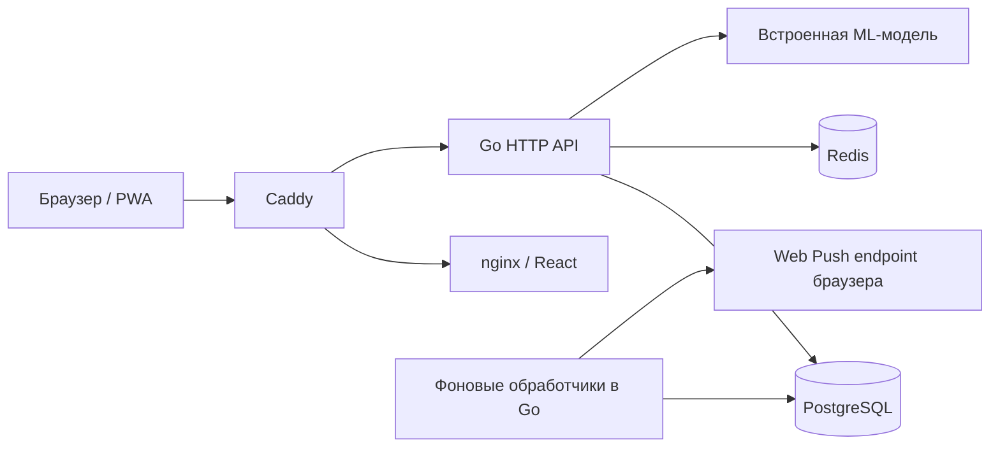

# Архитектура

Ритм — модульный монолит: один Go-процесс обслуживает HTTP API и фоновые обработчики, отдельно от него раздаётся React-приложение.

## Границы модулей

`cmd/server/main.go` создаёт зависимости и регистрирует маршруты. Общая инфраструктура лежит в `internal/core`, предметные сценарии — в `internal/features`.

| Модуль | Ответственность |
| --- | --- |
| `users`, `auth` | Регистрация, профиль, пароли, JWT, refresh-сессии |
| `tasks` | Задачи, сроки, завершение, повторения, важность и длительность |
| `events` | События расписания |
| `reminders` | Настройки интервалов, очередь, просроченные повторения, Web Push |
| `reports` | Агрегация выполнения и просрочек по датам |
| `priorities` | Снимки признаков, базовый прогноз, личные поправки, рекомендации |

Внутри модуля `transport/http` разбирает запрос и формирует ответ, `service` реализует сценарий, `repository/postgres` хранит SQL, `domain` определяет данные и правила. Зависимости передаются конструкторами; сервисы можно тестировать с подменой репозитория. Новую функцию обычно можно проследить от `Routes()` к сервису и SQL в пределах одного каталога.

## Сессии и разделение данных

API использует префикс `/api/v1`. Регистрация, вход и refresh доступны без access JWT; предметные маршруты защищены middleware. Идентификатор аккаунта поступает из проверенного токена. Access JWT короткоживущий, refresh находится в HttpOnly-cookie; его замена и отзыв выполняются атомарно. Во frontend запросы обновления сериализуются, в том числе между вкладками при поддержке Web Locks.

Основные группы маршрутов: `/auth/*`, `/users/me`, `/tasks`, `/events`, `/reminders/*`, `/reports/*`. `GET /tasks/priorities` возвращает оценки, рекомендации и статистику категорий; точный контракт — в [ML-PRIORITIES.md](ML-PRIORITIES.md).

## Время, напоминания и фоновые задачи

Сроки хранятся как временные отметки PostgreSQL; отчёт принимает IANA-зону пользователя. Завершение после срока остаётся опозданием даже после отметки «выполнено». Настройки напоминаний хранятся в аккаунте, изменение интервалов пересчитывает будущую очередь. Незавершённые просроченные задачи напоминают о себе каждые два часа.

Фоновые обработчики запускаются в Go-процессе. Они доставляют push и синхронизируют ML-наблюдения. После изменения задачи ML обновляется best-effort; при ошибке фоновый проход повторяет работу. Обычный список по времени остаётся доступным при ошибке API приоритетов.

## Почему ML работает внутри Go

Базовая модель обучается отдельным воспроизводимым Python-скриптом; JSON-артефакт встроен через `go:embed`. Production не требует Python, отдельного сервиса или сетевого запроса к провайдеру модели. Это упрощает эксплуатацию небольшого проекта и сохраняет тексты задач внутри приложения.

Признаки фиксируются до известного исхода, а переобучение личных поправок использует ограниченное окно наблюдений. Версия модели включает хеш весов и схему признаков. При смене несовместимой версии профиль начинает новую историю. Подробности защиты от утечки исхода в признаки — в [ML-PRIORITIES.md](ML-PRIORITIES.md).

## Загрузка и эксплуатация

Frontend собирается в статические файлы. Хешированные JS/CSS/WebP получают длительный immutable-кеш; service worker кеширует оболочку. API и личные данные не превращаются в offline-хранилище. Для синхронизации требуется сеть.

Для знакомства есть изолированный `compose.local.yml`: исходники собираются в Docker, приложение доступно только на loopback-порту 8088. Production использует `docker-compose.yml`, Caddy с TLS, резервное копирование PostgreSQL и Linux-бинарник, собранный локально и доставленный через git. Это отдельный путь выпуска, сохранённый для небольшого VDS.
